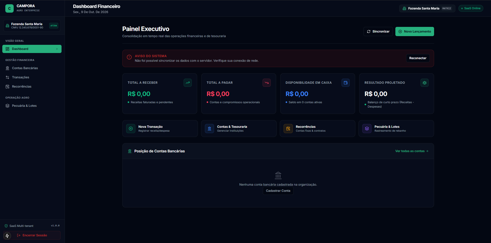
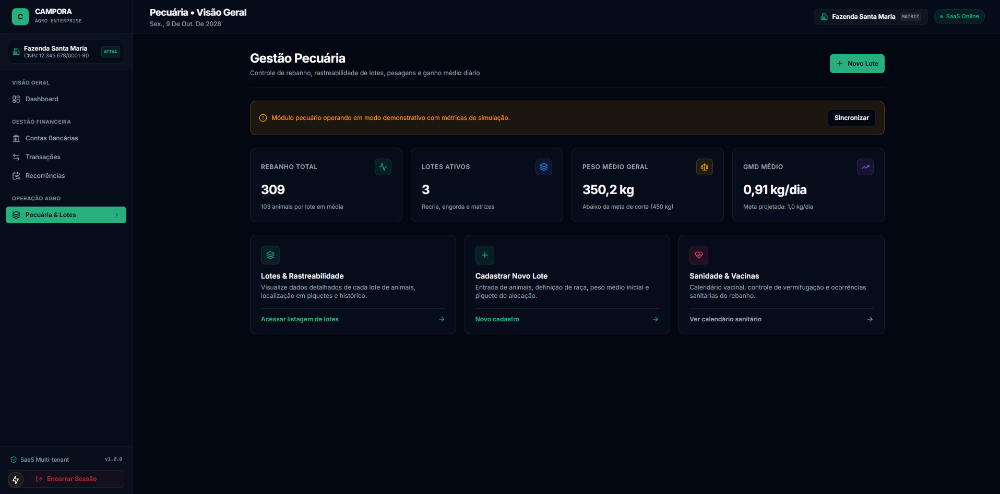
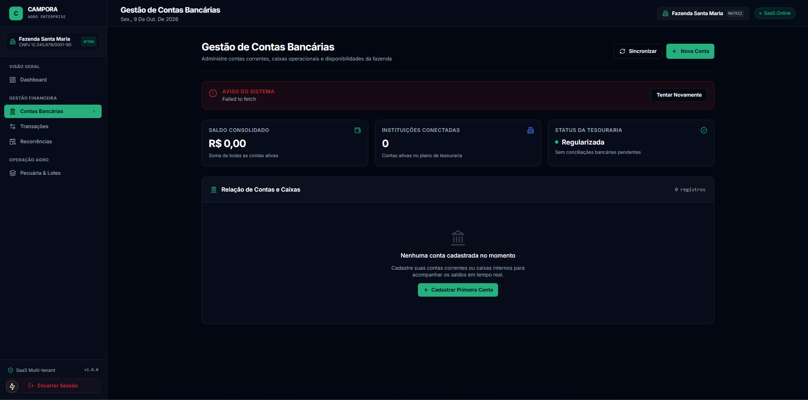
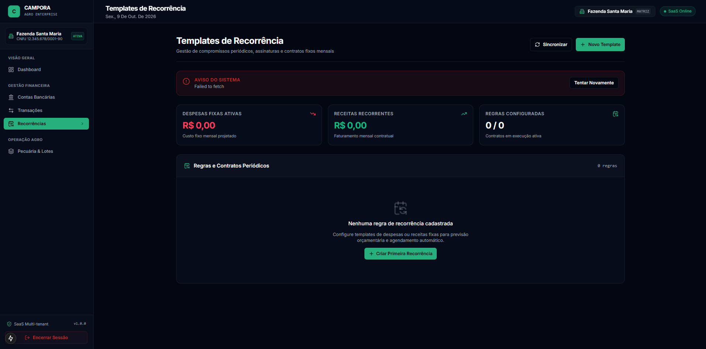

# Campora — Agro Enterprise SaaS (MVP em Desenvolvimento)

O **Campora** é um SaaS B2B Multi-tenant focado na gestão unificada de operações financeiras e recursos agropecuários. Este repositório atua como um estudo de caso técnico da arquitetura de software e da interface de utilizador, atualmente em fase de desenvolvimento inicial.

> **Nota de Confidencialidade:** O código-fonte integral e as lógicas de negócio centrais são mantidos em repositórios privados. Este espaço exibe exclusivamente a estrutura arquitetural, os desafios de engenharia resolvidos e as capturas do design da interface.

## 🏗️ Arquitetura e Engenharia Backend

O núcleo do sistema exige isolamento estrito de dados entre diferentes organizações e flexibilidade estrutural para configurações de utilizador.

* **Isolamento Multi-tenant Absoluto:** Arquitetura construída sobre **Java 21** e **Spring Boot 3.2**, utilizando a injeção de `@Filter` nativa do **Hibernate 6.4**. O contexto do tenant é extraído via JWT e propagado pelo `TenantInterceptor` e `TenantAwareJpaTransactionManager`, garantindo que todas as operações de leitura, escrita e exclusões lógicas sejam filtradas a nível de sessão do banco de dados antes da emissão do SQL.
* **Persistência de Dados Flexíveis:** Adoção de colunas nativas `JSONB` no **PostgreSQL** para armazenar definições de organização e preferências de utilizadores. A tipagem é resolvida em tempo de execução via `@JdbcTypeCode(SqlTypes.JSON)` do Hibernate, permitindo consultas otimizadas sem quebrar a desserialização do Jackson na camada API.
* **Evolução de Esquema:** Versionamento contínuo e determinístico do banco de dados orquestrado pelo **Flyway**.

## 🎨 Interface e Experiência de Utilizador (UI/UX)

Desenvolvida com **Next.js (App Router)** e **React**, a interface adota uma abordagem moderna e responsiva, otimizada para operações financeiras complexas. (Design e implementação de UI por Samuel).

* **Dashboard Executivo:** Consolidação em tempo real das operações de tesouraria com tratamento elegante de estados vazios (empty states) e falhas de sincronização de rede.
* **Tematização Dinâmica:** Design system fortemente apoiado em *Dark Mode* para reduzir o cansaço visual durante o uso prolongado do software de gestão.

## 📸 Demonstração Visual

| Gestão Financeira | Pecuária e Operações |
| :---: | :---: |
|  |  |
|  |  |

## 👨‍💻 Autoria e Desenvolvimento

* **Enzo Campos:** Arquiteto de Software e Engenheiro Backend (Java, Spring Boot, Arquitetura Multi-tenant).
* **Samuel:** Engenheiro Frontend e UI/UX (Next.js, React).